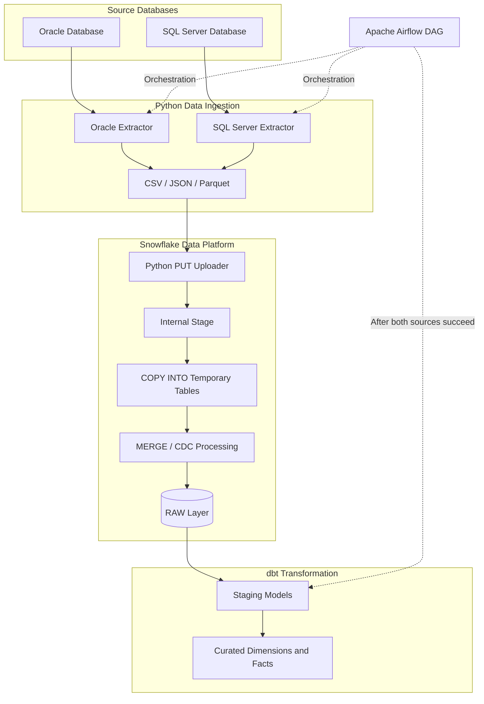

# Enterprise Multi-Source Data Engineering Pipeline

An end-to-end enterprise data engineering project integrating **Oracle, Microsoft SQL Server, Python, Snowflake, dbt and Apache Airflow**.

This project demonstrates incremental data extraction from multiple relational databases, multi-format data processing, automated ingestion into Snowflake, data consolidation, transformation and workflow orchestration.

> **Project status:** The implemented and successfully tested workflow integrates Oracle and SQL Server with Snowflake, dbt and Airflow. External-file ingestion and Snowpipe are planned extensions.

---

## Architecture



## Technology Stack

| Technology | Purpose |
|---|---|
| Oracle Database | Customer and order source |
| Microsoft SQL Server | Product and inventory source |
| Python | Extraction, validation and ingestion |
| CSV, JSON, Parquet | Multi-format data processing |
| Snowflake | Cloud data warehouse |
| Snowflake Internal Stage | Data file landing |
| COPY INTO | Loading staged files |
| MERGE | Incremental data consolidation |
| dbt Core | Data transformation and testing |
| Apache Airflow | Pipeline orchestration |
| Git / GitHub | Source control and project management |

## End-to-End Data Flow

### 1. Source extraction

Extracts data from two independent relational database systems.

**Oracle**
- CUSTOMERS
- ORDERS

**SQL Server**
- PRODUCTS
- INVENTORY

Python extraction scripts connect directly to the respective databases.

### 2. Multi-format data generation

Extracted records are written into three formats:

- CSV
- JSON
- Parquet

The source views partition records across the three formats, allowing the combined files to represent the complete extracted delta.

### 3. Snowflake ingestion

Python Snowflake Connector handles:

1. Uploading files using `PUT`.
2. Landing files in a Snowflake internal stage.
3. Loading data using `COPY INTO`.
4. Loading into temporary tables.
5. Deduplicating records using business keys.
6. Merging records into RAW tables.

### 4. Incremental data processing

The ingestion process uses:

- `UPDATED_AT` timestamps.
- Five-minute overlap window.
- Source partition count validation.
- Business-key-based deduplication.
- Incremental `MERGE` processing.

The pipeline reads the latest source watermark from the corresponding Snowflake RAW table.

### 5. dbt transformations

The dbt project implements staging and curated models.

**Staging models**
- `stg_oracle_customers`
- `stg_oracle_orders`
- `stg_sqlserver_products`
- `stg_sqlserver_inventory`

**Curated models**
- `dim_customers`
- `dim_products`
- `fct_orders`
- `fct_inventory`

### 6. Apache Airflow orchestration

The Airflow DAG coordinates:

1. Oracle extraction and ingestion.
2. SQL Server extraction and ingestion.
3. dbt build after both source tasks complete successfully.

The DAG uses manual triggering (`schedule=None`).

---

## Initial Data Volume

The initial source snapshot loaded into Snowflake contained 27,000 records.

| Source | Entity | Records |
|---|---|---:|
| Oracle | Customers | 5,000 |
| Oracle | Orders | 20,000 |
| SQL Server | Products | 500 |
| SQL Server | Inventory | 1,500 |
| **Total** | | **27,000** |

The project is designed around incremental extraction rather than repeatedly loading the entire source dataset.

## Snowflake Architecture

Database: `ENTERPRISE_DW`

| Layer | Purpose |
|---|---|
| RAW | Source-aligned data |
| STAGING | dbt staging transformations |
| CURATED | Business-ready dimensions and facts |
| AUDIT | Audit and watermark objects |
| UTILS | Utility objects |

Warehouse: `ENTERPRISE_WH`

Internal Stage:

`ENTERPRISE_DW.RAW.STG_ENTERPRISE_LANDING`

## Repository Structure

```text
enterprise-multi-source-data-engineering/
│
├── airflow/
│   └── dags/
│       └── enterprise_multi_source_dag.py
│
├── dbt_enterprise/
│   ├── models/
│   │   ├── sources/
│   │   ├── staging/
│   │   └── marts/
│   ├── macros/
│   ├── dbt_project.yml
│   └── profiles.example.yml
│
├── ingestion/
│   ├── oracle/
│   ├── sql_server/
│   └── file_ingestion/
│
├── Oracle Scripts/
├── SQL Server scripts/
├── Snowflake Scripts/
│
├── docs/
│   ├── PROJECT_RUNBOOK.md
│   ├── REPOSITORY_AUDIT.md
│   └── FILE_INVENTORY.txt
│
├── audit_extractions.py
├── generate_source_data.py
├── load_raw_to_snowflake.py
├── run_source_pipeline.py
├── upload_to_snowflake_stage.py
├── test_connections.py
├── test_snowflake_connection.py
│
├── requirements-project.txt
├── .env.example
├── .gitignore
└── README.md
```

## Getting Started

### Prerequisites

- Oracle Database
- Microsoft SQL Server
- Snowflake account
- Python environment
- Oracle and SQL Server database drivers
- dbt Core with Snowflake adapter
- Apache Airflow

### Environment configuration

Create a local `.env` file from `.env.example`.

Configure your Oracle, SQL Server and Snowflake connection details.

For dbt, configure the local `profiles.yml` using `dbt_enterprise/profiles.example.yml` as a template.

**Never commit actual passwords, credentials or private connection details.**

### Run source pipelines

From the project root, activate the Python ingestion environment and execute:

```bash
python run_source_pipeline.py --source oracle
```

```bash
python run_source_pipeline.py --source sql_server
```

The initial Snowflake RAW snapshot and its watermark columns must be prepared before running incremental extraction.

### Run dbt

Navigate to `dbt_enterprise` and execute:

```bash
dbt build
```

### Run Apache Airflow

Activate the Airflow environment and start:

```bash
airflow standalone
```

Open:

`http://localhost:8080`

Trigger the DAG:

`enterprise_multi_source_pipeline`

Verify that both source tasks and the dbt task complete successfully.

Refer to [PROJECT_RUNBOOK.md](docs/PROJECT_RUNBOOK.md) for the complete setup, configuration, SQL execution order and operational instructions.

---

## Engineering Concepts Demonstrated

- Multi-source database integration.
- Incremental data extraction.
- Watermark-based processing.
- Data partitioning across multiple file formats.
- CSV, JSON and Parquet processing.
- Snowflake staging and bulk loading.
- SQL MERGE and CDC patterns.
- Data reconciliation and validation.
- dbt staging and dimensional modelling.
- Airflow DAG orchestration.
- Environment-based credential management.
- Git version control.

## Current Implementation Scope and Future Enhancements

| Component | Status |
|---|---|
| Oracle extraction | Implemented |
| SQL Server extraction | Implemented |
| CSV / JSON / Parquet generation | Implemented |
| Snowflake internal stage ingestion | Implemented |
| Snowflake COPY INTO and MERGE | Implemented |
| dbt transformations | Implemented |
| Airflow orchestration | Implemented and tested |
| External-file ingestion | Planned |
| Snowpipe automation | Planned |
| Cloud storage integration | Planned |
| Automated CI/CD | Planned |

**Reproducibility note:** Some source DDL, especially Oracle CDC column setup, needs additional documentation for a completely clean-room rebuild. The Airflow DAG also contains workstation-specific paths that must be adapted on another machine. See [REPOSITORY_AUDIT.md](docs/REPOSITORY_AUDIT.md).

## Documentation

- [Project Runbook](docs/PROJECT_RUNBOOK.md)
- [Repository Audit](docs/REPOSITORY_AUDIT.md)
- [File Inventory](docs/FILE_INVENTORY.txt)

## Author

**Kiran Kumar**

Senior Software Engineer | Data Warehousing | Data Engineering | Database Modelling | Database Designing

GitHub: [Kiran-data-lab](https://github.com/Kiran-data-lab)

---

*This project is a hands-on enterprise data engineering implementation demonstrating integration of traditional relational databases with modern cloud data warehousing and orchestration technologies.*
