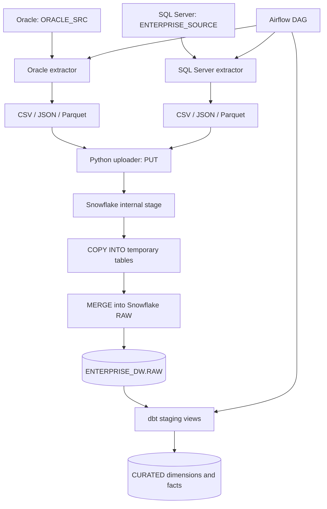

# Enterprise Multi-Source Data Engineering Pipeline

An end-to-end learning project that extracts data from Oracle and SQL Server, lands multi-format files in a Snowflake internal stage, merges the data into Snowflake RAW tables, transforms it with dbt, and orchestrates the workflow with Apache Airflow.

> **Implementation scope:** The successful Airflow workflow currently integrates Oracle and SQL Server. External-file ingestion is not implemented in the final DAG. The project uses Snowflake `PUT` + `COPY INTO` + `MERGE`; it does not use Snowpipe.

## Architecture



## Repository layout

```text
snowflake-data-engineering/
├── airflow/
│   └── dags/
│       └── enterprise_multi_source_dag.py
├── dbt_enterprise/
│   ├── dbt_project.yml
│   ├── profiles.example.yml
│   ├── macros/
│   └── models/
│       ├── sources/
│       ├── staging/
│       └── marts/
├── ingestion/
│   ├── oracle/extract_oracle.py
│   ├── sql_server/extract_sqlserver.py
│   └── file_ingestion/              # reserved; not implemented
├── Oracle Scripts/
├── SQL Server scripts/
├── Snowflake Scripts/
├── audit_extractions.py
├── generate_source_data.py
├── load_raw_to_snowflake.py
├── run_source_pipeline.py
├── test_connections.py
├── test_snowflake_connection.py
└── upload_to_snowflake_stage.py
```

See [`docs/PROJECT_RUNBOOK.md`](docs/PROJECT_RUNBOOK.md) for the full setup, SQL execution order, script responsibilities, command examples, Airflow flow, dbt models, and operating procedure. See [`docs/REPOSITORY_AUDIT.md`](docs/REPOSITORY_AUDIT.md) for limitations and items that must be completed before claiming a clean-room rebuild.

## Current project objects

- Snowflake database: `ENTERPRISE_DW`
- Schemas: `RAW`, `STAGING`, `CURATED`, `AUDIT`, `UTILS`
- Warehouse: `ENTERPRISE_WH` (XSMALL; auto-suspend 60 seconds; auto-resume enabled)
- Internal stage: `ENTERPRISE_DW.RAW.STG_ENTERPRISE_LANDING`
- Oracle source: PDB service `ORCLPDB`, schema `ORACLE_SRC`, read-only extraction user `ORACLE_ETL`
- SQL Server source: database `ENTERPRISE_SOURCE`, schema `SQLSERVER_SRC`, extraction login/user `ETL_READER`
- Airflow DAG ID: `enterprise_multi_source_pipeline`

## Initial source volume

The initial source snapshot loaded into Snowflake contained 27,000 rows:

| Source | Entity | Initial rows |
|---|---|---:|
| Oracle | CUSTOMERS | 5,000 |
| Oracle | ORDERS | 20,000 |
| SQL Server | PRODUCTS | 500 |
| SQL Server | INVENTORY | 1,500 |
| **Total** | | **27,000** |

## Runtime environments

The project uses separate environments for source ingestion, Airflow, and dbt:

- WSL / Ubuntu 26.04.1, Python 3.14.4, project venv `~/snowflake-oracle-venv`
- WSL Airflow venv `~/airflow-project/.venv`, Airflow 3.3.2
- Windows dbt venv `C:\snowflake-dbt\.venv`, dbt Core 1.12.5, dbt-snowflake 1.12.1

The actual `.env` and the user's dbt `profiles.yml` are intentionally not included. Create them locally from the examples and keep credentials out of Git.

## Quick run

Run source pipelines from WSL:

```bash
cd /mnt/e/Snowflake/snowflake-data-engineering
source ~/snowflake-oracle-venv/bin/activate
python run_source_pipeline.py --source oracle
python run_source_pipeline.py --source sql_server
```

Run Airflow:

```bash
source ~/airflow-project/.venv/bin/activate
export AIRFLOW_HOME=~/airflow-project/airflow-home
airflow standalone
```

Open `http://localhost:8080`, manually trigger `enterprise_multi_source_pipeline`, and check that `run_source`, `run_source_1`, and `run_dbt` are all successful.

The DAG is configured with `schedule=None`; it does not run on a recurring schedule.

## Git safety

Do not commit `.env`, dbt `profiles.yml`, generated extracts under `data/`, Python virtual environments, Airflow runtime databases/logs, or dbt `target/` output. The repository includes `.gitignore` and `.env.example`.
